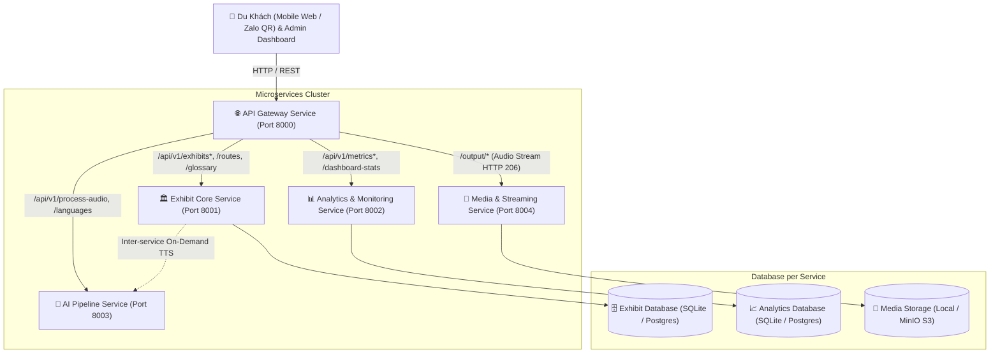

# 🏛️ Kiến Trúc Microservices — WarRemnantsVoice (Bảo Tàng Chứng Tích Chiến Tranh)

Hệ thống đã được tái cấu trúc từ mô hình Monolith sang **Kiến Trúc Microservices Chuẩn Doanh Nghiệp (Production-Grade Microservices Architecture)**, đáp ứng đầy đủ các tiêu chuẩn phân tách nghiệp vụ, khả năng mở rộng độc lập và vận hành linh hoạt.

---

## 🗺️ 1. Sơ Đồ Kiến Trúc Tổng Thể



---

## 📦 2. Danh Sách & Nhiệm Vụ Từng Microservice

| Tên Dịch Vụ | Thư Mục | Port | Nhiệm Vụ Trọng Tâm | Công Nghệ |
| :--- | :--- | :---: | :--- | :--- |
| **API Gateway** | `services/gateway-service` | **8000** | Cổng giao tiếp tập trung duy nhất cho Frontend. Xử lý định tuyến (Reverse Proxy), Health check cluster, CORS, bảo mật. | FastAPI, HTTPX Async |
| **Exhibit Core Service** | `services/exhibit-service` | **8001** | Quản lý vòng đời hiện vật, phòng trưng bày, tour chuyên đề, từ điển thuật ngữ lịch sử - quân sự, nạp dữ liệu mẫu seed. | FastAPI, SQLAlchemy |
| **Analytics & Metrics** | `services/analytics-service` | **8002** | Giám sát du khách thời gian thực: Heartbeat, đếm CCU, phiên truy cập, phân loại thiết bị, ghi nhận số liệu nghe audio. | FastAPI, SQLAlchemy |
| **AI Pipeline Service** | `services/ai-pipeline-service` | **8003** | Dịch thuật đa ngôn ngữ tự động (Deep Translator/Google Translate API), tổng hợp giọng nói AI (Microsoft Edge-TTS Neural), sinh phụ đề JSON. | FastAPI, Edge-TTS |
| **Media & Streaming** | `services/streaming-service` | **8004** | Phân phối file âm thanh MP3 tối ưu cho di động với chuẩn HTTP 206 Partial Content (tua nhanh không giật lag). | FastAPI, File Streaming |
| **Frontend SPA** | `services/frontend` | **5173** | Giao diện du khách quét QR nghe audio và Dashboard Quản trị Admin thời gian thực. | React, Vite, Tailwind |

---

## 🚀 3. Cách Khởi Động Hệ Thống

### Cách 1: Khởi động Cục Bộ Bằng 1 Click (Khuyến Nghị Cho Phát Triển Cục Bộ)
1. **Khởi động toàn bộ Microservices:**
   * Nhấp đúp vào file: [`start_all_microservices.bat`](file:///d:/VS%20Code/war-remnants-voice/start_all_microservices.bat)
   * Hệ thống sẽ tự động bật 5 dịch vụ Backend và 1 Frontend React trong các cửa sổ riêng biệt để bạn dễ dàng theo dõi log.
2. **Kiểm tra trạng thái Cluster:**
   * Mở trình duyệt: `http://localhost:8000/health` $\rightarrow$ Kiểm tra trạng thái "UP" của tất cả 5 service.
3. **Dừng toàn bộ hệ thống:**
   * Nhấp đúp vào file: [`stop_all_microservices.bat`](file:///d:/VS%20Code/war-remnants-voice/stop_all_microservices.bat)

### Cách 2: Khởi động Hoàn Toàn Bằng Docker Compose (Production-Ready)
```bash
docker compose up -d --build
```
* Bao gồm toàn bộ 6 container microservices kết hợp PostgreSQL, RabbitMQ và MinIO.

---

## 🔒 4. Nguyên Tắc Thiết Kế Đã Đạt Chuẩn

1. **Single Responsibility (Mỗi service 1 nhiệm vụ)**: Mỗi service quản lý 1 domain duy nhất (Hiện vật, Phân tích, AI, Streaming).
2. **Database per Service**: CSDL được phân ranh giới rõ ràng. Exhibit Service và Analytics Service sở hữu bảng và storage riêng.
3. **Decoupled Inter-Service Communication**: Exhibit Service gọi AI Service qua REST API / Event mà không phụ thuộc trực tiếp vào mã nguồn hay database của nhau.
4. **Single Entry Point**: Toàn bộ ứng dụng Client chỉ cần gọi qua API Gateway (Port 8000), giấu kín cấu trúc mạng nội bộ bên dưới.
